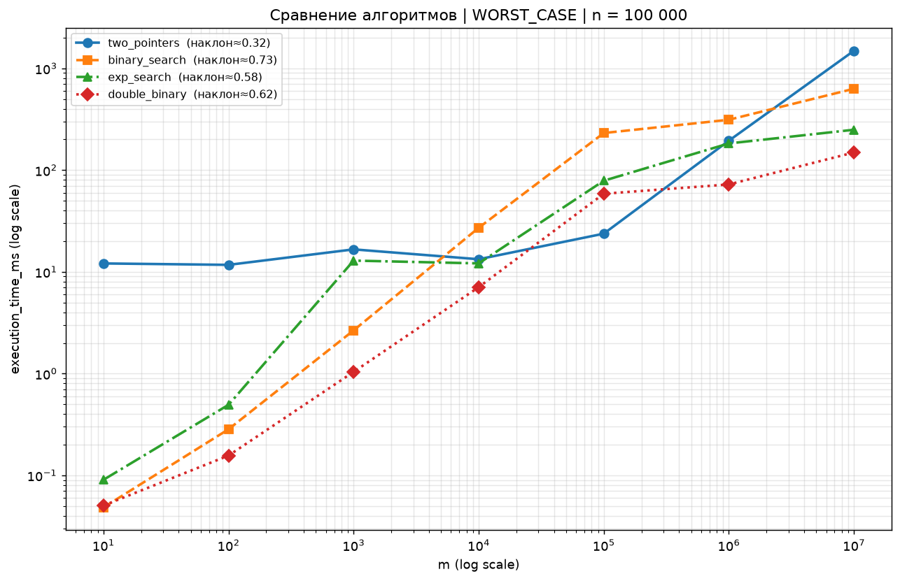
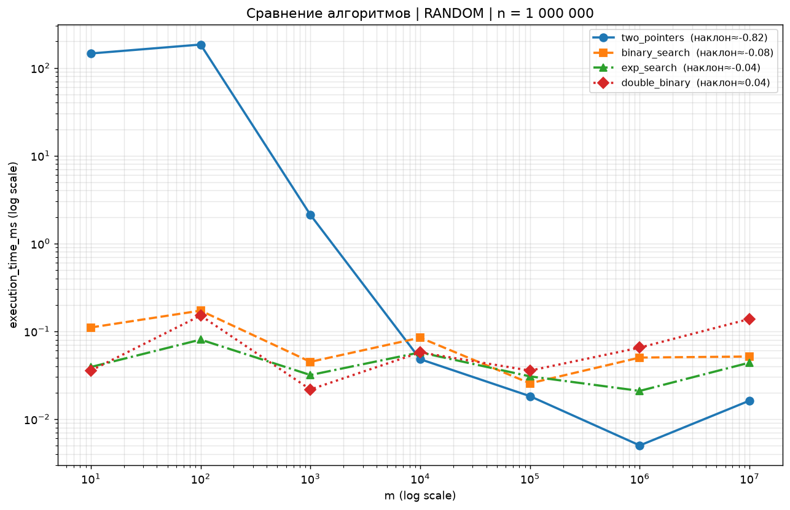
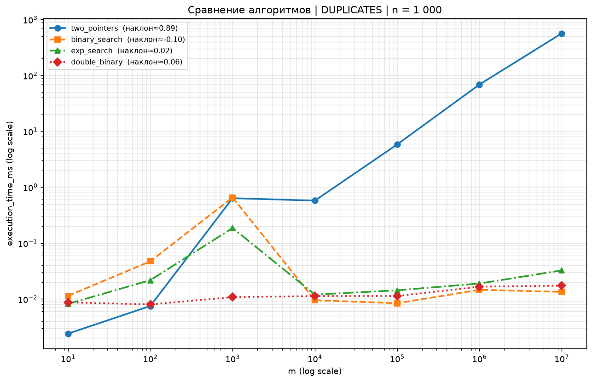

# Лабораторная работа № 1 — Поиск общего элемента в двух отсортированных массивах

## 1. Постановка задачи

Даны два отсортированных массива целых чисел длиной `M` и `N`.

Требуется вернуть `True`, если в массивах есть хотя бы один общий элемент, и `False` — в противном случае.

| Массив A      | Массив B      | Ответ   |
| ------------- | ------------- | ------- |
| `[1, 2, 3]`   | `[3, 4, 5]`   | `True`  |
| `[2, 4, 6]`   | `[3, 5, 7]`   | `False` |
| `[]`          | `[]`          | `False` |

## 2. Цель работы

1. Реализовать **четыре разных алгоритма** решения одной и той же задачи.
2. Экспериментально выяснить, **при каких размерах массивов `M` и `N` какой алгоритм эффективнее**.
3. Сопоставить результаты замеров с теоретическими оценками сложности.

## 3. Исследуемые алгоритмы

Общее для трёх поисковых алгоритмов (пп. 3.2–3.4): если первый массив длиннее второго, они **меняют массивы местами**, т. е. работа всегда ведётся от меньшего массива к большему. Поэтому их фактическая сложность выражается через `min(M, N)` и `max(M, N)`, а результат не зависит от порядка аргументов.

### 3.1. Два указателя — `algorithms/two_pointers.py`

По каждому массиву идёт свой указатель. На каждом шаге сдвигается указатель, указывающий на меньший элемент; равенство элементов означает, что общий элемент найден.

- Время: `O(M + N)`
- Память: `O(1)`

### 3.2. Бинарный поиск — `algorithms/binary_search.py`

Каждый элемент меньшего массива ищется бинарным поиском (`bisect.bisect_left`) в большем массиве.

- Время: `O(M · log N)`, в реализации — `O(min(M, N) · log max(M, N))`
- Память: `O(1)`

### 3.3. Экспоненциальный (галопирующий) поиск — `algorithms/exp_search.py`

Элементы меньшего массива перебираются по возрастанию. Внутри большего массива поддерживается монотонно растущая нижняя граница `bound`: от неё шаг удваивается (`1, 2, 4, …`), пока не будет пройдено искомое значение, затем позиция уточняется бинарным поиском внутри найденного короткого интервала.

- Время: `O(M · log(2N/M))`
- Память: `O(1)`

### 3.4. Бинарный поиск с разделением (двойной бинарный) — `algorithms/double_binary.py`

Берётся центральный элемент меньшего массива, бинарным поиском находится его позиция вставки в соответствующем сегменте большего массива. Если совпадения нет, задача рекурсивно решается для двух пар «половинок» слева и справа от найденных позиций.

- Время: `O(M · log(2N/M))`
- Память: `O(log M)` (глубина рекурсии)

### Сводная таблица

| Алгоритм | Файл | Время (по заданию) | Память |
|---|---|---|---|
| Два указателя | `algorithms/two_pointers.py` | `O(M + N)` | `O(1)` |
| Бинарный поиск | `algorithms/binary_search.py` | `O(M · log N)` | `O(1)` |
| Экспоненциальный поиск | `algorithms/exp_search.py` | `O(M · log(2N/M))` | `O(1)` |
| Двойной бинарный поиск | `algorithms/double_binary.py` | `O(M · log(2N/M))` | `O(log M)` |

## 4. Структура репозитория

```
aisd-lab1/
├── README.md
├── algorithms/
│   ├── two_pointers.py     # два указателя
│   ├── binary_search.py    # бинарный поиск
│   ├── exp_search.py       # экспоненциальный поиск
│   └── double_binary.py    # двойной бинарный поиск
├── testing.py              # генераторы данных, проверка корректности, замеры (pytest)
├── conftest.py             # слияние CSV-результатов воркеров pytest-xdist
├── plot_results.py         # построение графиков по test_results.csv
├── test_results.csv        # сырые данные замеров (784 строки)
├── plots_by_n/             # 144 PNG-графика + winners.csv
├── pyproject.toml
└── uv.lock
```

## 5. Методика эксперимента

Код запуска тестов и проверки работоспособности — `testing.py` (pytest). Каждый тест одновременно:

1. генерирует данные заданного сценария заданных размеров;
2. замеряет время работы алгоритма через `time.perf_counter()` (генерация данных в замер **не** входит);
3. **проверяет корректность**: `assert result == answer`, где эталонный ответ для части сценариев вычисляется пересечением множеств `set(a) & set(b)`.

### 5.1. Сценарии данных

| Сценарий | Генерация | Смысл |
|---|---|---|
| `RANDOM` | Случайные числа из `[0, 10·max(M, N)]`, сортировка | Средний случай |
| `WORST_CASE` | A — только чётные, B — только нечётные числа (`random.sample` по диапазонам с шагом 2) | Пересечений нет: алгоритм обязан доработать до конца. Худший случай для всех алгоритмов, рекомендован в задании |
| `BEST_CASE` | Случайные массивы, общий элемент `0` принудительно ставится в начало обоих | Пересечение находится на первых же элементах |
| `DUPLICATES` | Числа из узких диапазонов `[0, 5]` и `[3, 8]` | Много дубликатов, мало уникальных значений |

### 5.2. Размеры и объём замеров

`M, N ∈ {10¹, 10², …, 10⁷}` во всех комбинациях: 49 пар размеров × 4 сценария × 4 алгоритма = **784 замера** — именно столько строк в `test_results.csv` (колонки: `scenario_name, algorithm, m, n, execution_time, execution_time_ms`).

Замеры запускаются параллельно через `pytest-xdist`: каждый воркер пишет свой `test_results_<worker>.csv`, а `conftest.py` после завершения сессии склеивает их в единый `test_results.csv`.

### 5.3. Графики

`plot_results.py` строит по `test_results.csv` три группы графиков, у всех графиков **обе оси логарифмические** (как рекомендовано в задании):

- **A.** `{algorithm}_{scenario}_n={n}.png` — время от `M` для каждого алгоритма по отдельности, с оценкой наклона log-log прямой;
- **B.** `compare_{scenario}_n={n}.png` — все алгоритмы на одном графике при фиксированном `N`;
- **C.** `compare_{scenario}_all_n.png` — обзорные графики: все алгоритмы × все значения `N`.

Итого 144 PNG в `plots_by_n/`, плюс таблица `plots_by_n/winners.csv` — победитель по медианному времени для каждой пары (сценарий, `N`).

## 6. Как запустить

Требуется Python ≥ 3.11 и [uv](https://docs.astral.sh/uv/).

```bash
uv sync                            # установить зависимости
uv run pytest testing.py -n auto   # тесты + замеры -> test_results.csv
uv run python plot_results.py      # графики -> plots_by_n/
```

Зависимости (`pyproject.toml`): `pytest`, `pytest-xdist`, `matplotlib`, `numpy`, `pandas`.

## 7. Результаты

Итоги по данным `test_results.csv`: число побед алгоритма в отдельных комбинациях `(M, N)` внутри сценария (всего 49 комбинаций на сценарий):

| Сценарий | two_pointers | binary_search | exp_search | double_binary |
|---|---:|---:|---:|---:|
| `BEST_CASE` | **49** | 0 | 0 | 0 |
| `WORST_CASE` | 4 | **42** | 0 | 3 |
| `RANDOM` | 12 | **24** | 8 | 5 |
| `DUPLICATES` | 18 | **22** | 0 | 9 |

Победитель по медианному времени при фиксированном `N` (из `plots_by_n/winners.csv`):

| Сценарий | Победитель |
|---|---|
| `BEST_CASE` | `two_pointers` при всех `N` |
| `WORST_CASE` | `binary_search` при всех `N` |
| `RANDOM` | `binary_search` при всех `N`, кроме `N = 100` (`two_pointers`) |
| `DUPLICATES` | `binary_search` при `N ≤ 10⁴`, `double_binary` при `N ≥ 10⁵` |

Характерные замеры, худший случай (`WORST_CASE`, время в мс):

| M | N | two_pointers | binary_search | exp_search | double_binary |
|---:|---:|---:|---:|---:|---:|
| 10 | 10⁷ | 1712,6 | **0,05** | 0,16 | 0,08 |
| 10⁷ | 10 | 1816,4 | 0,06 | 0,13 | **0,06** |
| 10³ | 10⁷ | 1381,4 | **2,08** | 6,50 | 3,02 |
| 10⁶ | 10⁶ | **291,3** | 436,0 | 465,9 | 619,3 |
| 10⁷ | 10⁷ | 3382,9 | 3856,2 | 6115,7 | **3172,0** |

### Ключевые графики

Ниже — самые показательные графики из `plots_by_n/`: по одному на каждый сценарий плюс график точки пересечения в худшем случае. Выбраны сравнительные графики (`compare_*`, все 4 алгоритма при фиксированном `N`): обзорные графики `*_all_n` содержат по 28 линий и для чтения малопригодны. У всех графиков обе оси логарифмические, в легенде указан наклон log-log прямой.


*Рис. 1 — `WORST_CASE`, `N = 10⁷` (главный график работы). Два указателя идут почти горизонтально на уровне ~2 с: при любом `M` им приходится проходить весь массив из 10⁷ элементов. Поисковые алгоритмы растут от 0,05–0,16 мс при `M = 10` (перебирается маленький массив) и сходятся к двум указателям только при `M = N`. Бинарный поиск — нижняя линия почти на всём диапазоне.*



*Рис. 2 — `WORST_CASE`, `N = 10⁵`: точка пересечения. При `M ≪ N` поисковые алгоритмы быстрее на 2–3 порядка, но по мере приближения `M` к `N` кривые сходятся (при `M = N = 10⁵` все алгоритмы в диапазоне 34–70 мс), а при `M > N` два указателя снова оказываются медленнее всех. Видно, что преимущество бинарного поиска — именно эффект сильно различающихся размеров.*


*Рис. 3 — `BEST_CASE`, `N = 10⁵`. Все линии почти горизонтальны (наклоны ≈ 0): общий элемент стоит первым, время не зависит от размеров массивов. Два указателя стабильно ниже всех (~0,002–0,006 мс), выше всех — двойной бинарный поиск: плата за рекурсию и вызовы `bisect_left` даже при мгновенном ответе.*



*Рис. 4 — `RANDOM`, `N = 10⁶`. Поисковые алгоритмы идут плоско на уровне 0,02–0,06 мс: общий элемент находится за первые несколько проб (ранний выход). Время двух указателей, наоборот, падает с ростом `M` (наклон ≈ −0,72): чем больше первый массив, тем раньше при линейном проходе встретится общий элемент, а при `M = 10` приходится сканировать почти весь миллионный массив (~300 мс).*



*Рис. 5 — `DUPLICATES`, `N = 10³`. Два указателя растут линейно (наклон ≈ 0,96, до ~450 мс): совпадений «почти» много, но проход всё равно длинный. Поисковые алгоритмы после `M = 10⁴` выходят на плато ~0,005–0,02 мс: они перебирают меньший массив (здесь это массив длины `N = 10³` после перестановки) и сразу попадают в общий диапазон значений 3–5.*

Остальные графики: индивидуальные — `{algorithm}_{scenario}_n={n}.png`, сравнительные для других `N` — `compare_{scenario}_n={n}.png`, обзорные по всем `N` — `compare_{scenario}_all_n.png`.

## 8. Выводы

1. **Лучший случай** (`BEST_CASE`): два указателя выигрывают во всех 49 комбинациях — общий первый элемент находится за несколько сравнений, без накладных расходов на бинарный поиск и рекурсию.
2. **Асимметрия размеров — главный фактор.** Если пересечения нет (`WORST_CASE`), а размеры сильно различаются, бинарный поиск быстрее на порядки: при `M = 10, N = 10⁷` — 0,05 мс против ~1700 мс у двух указателей, которым приходится линейно проходить оба массива целиком. Это прямо подтверждает преимущество `O(min(M, N) · log max(M, N))` над `O(M + N)` при `M ≪ N`.
3. **При сравнимых размерах** (`M ≈ N`) и отсутствии пересечения линейный проход конкурентен и иногда быстрее (при `M = N = 10⁶` два указателя — 291 мс против 436 мс у бинарного поиска; при `M = N = 10⁷` первым оказался двойной бинарный). Разрыв между алгоритмами здесь невелик и сопоставим с шумом замеров — решает константа, а не асимптотика.
4. **Три поисковых алгоритма симметричны** относительно порядка массивов, так как перебирают меньший массив: времена для пар `(M, N)` и `(N, M)` практически совпадают (ср. первые две строки таблицы в разделе 7).
5. **Экспоненциальный поиск не дал преимущества** над обычным бинарным ни в худшем случае, ни (устойчиво) в среднем, несмотря на лучшую теоретическую оценку при `M ≪ N`: `bisect_left` в CPython реализован на C и очень быстр, а выигрыш от сужения интервала поиска съедается Python-циклом галопирования.
6. **Двойной бинарный поиск** в целом немного уступает обычному бинарному, но при большом количестве дубликатов (`DUPLICATES`, `N ≥ 10⁵`) выходит на первое место по медиане: время почти не растёт с `N` (~0,017 мс), так как центральный элемент почти сразу попадает в диапазон общих значений.
7. **`RANDOM` и `DUPLICATES`**: время в основном определяет то, насколько рано встретится первый общий элемент (ранний выход), а не полная асимптотика — поэтому победитель меняется от комбинации к комбинации, хотя чаще впереди бинарный поиск.

**Итоговая рекомендация по выбору алгоритма:**

| Ситуация | Рекомендуемый алгоритм |
|---|---|
| Размеры сильно различаются (`M ≪ N` или `N ≪ M`) | Бинарный поиск по большему массиву |
| Размеры сравнимы, пересечения может не быть | Два указателя или бинарный поиск |
| Общий элемент ожидается в начале массивов | Два указателя |
| Очень много дубликатов, массивы большие | Двойной бинарный поиск |

### Ограничения методики

- На каждую комбинацию делается **один замер без повторов и усреднения**, поэтому на малых размерах и в сценариях с ранним выходом результаты заметно шумят; строгие выводы надёжны только для `WORST_CASE` на больших размерах.
- Генераторы используют `random` **без фиксированного seed**: наборы данных от запуска к запуску различаются, замеры воспроизводимы лишь приближённо.
- Сравниваются реализации, а не «чистые» алгоритмы: `bisect_left` — C-реализация из стандартной библиотеки, а остальные алгоритмы написаны на чистом Python, что даёт бинарному поиску преимущество в константе.
