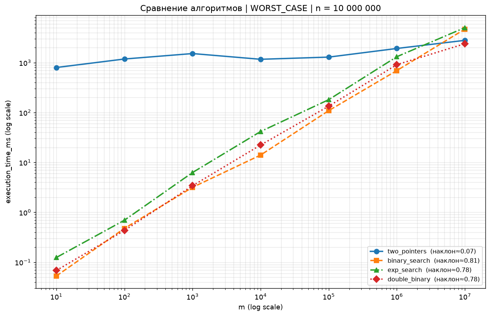
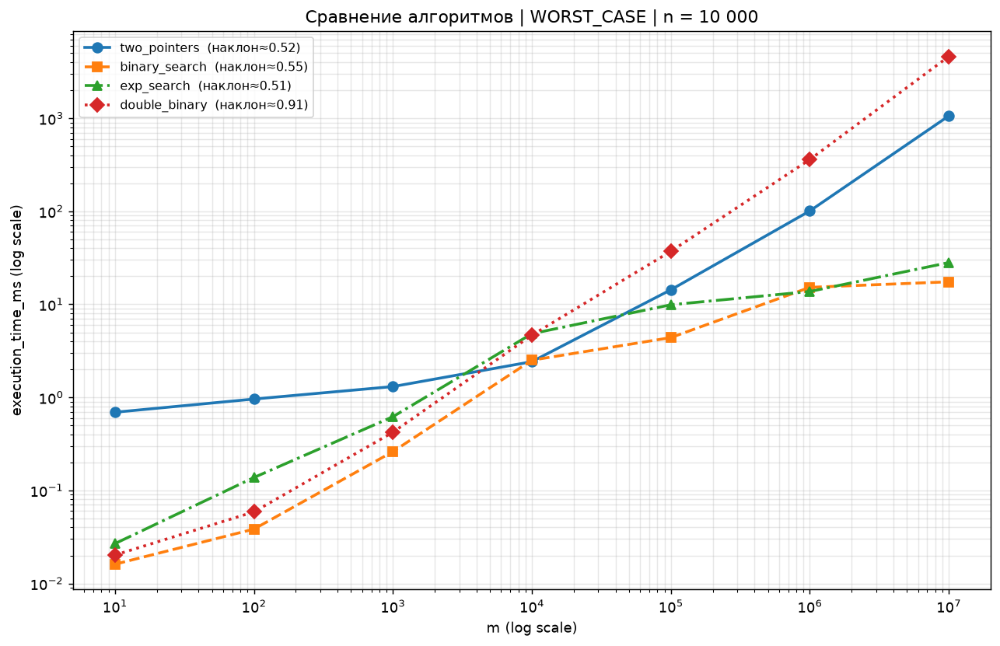
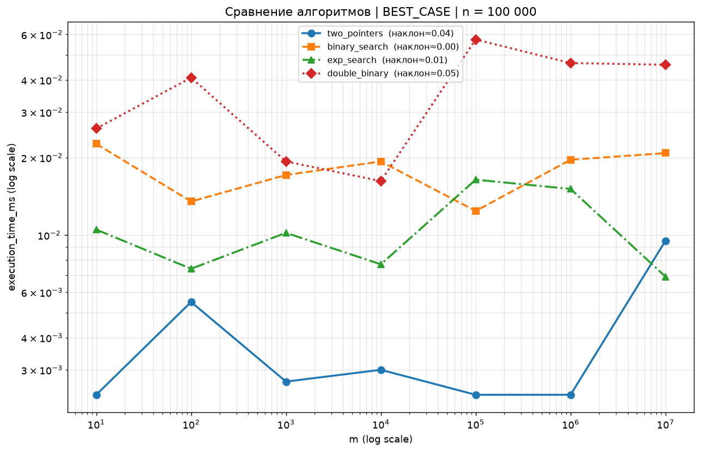
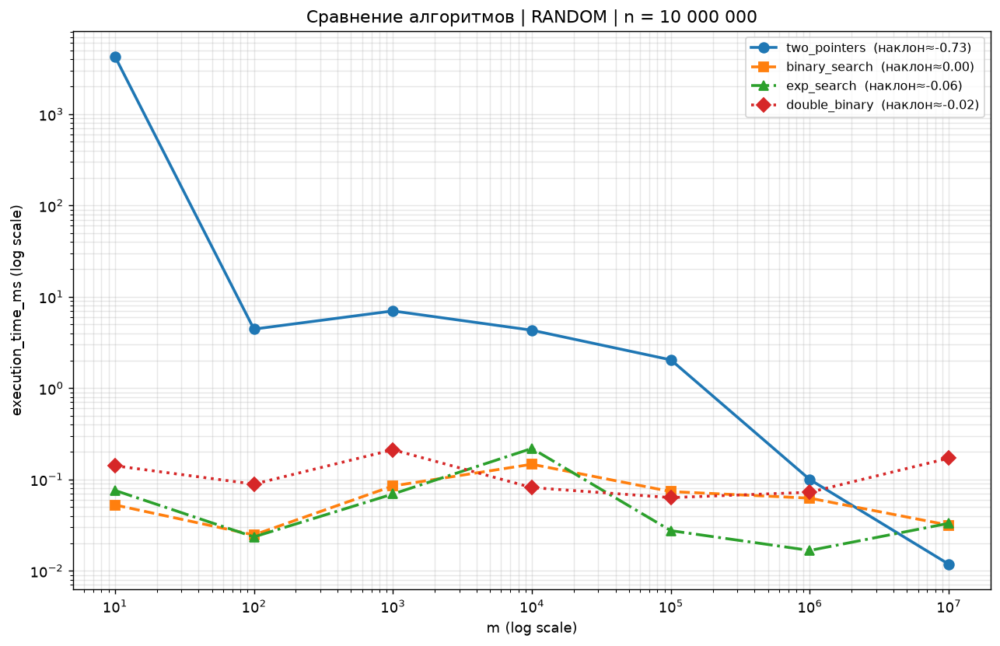
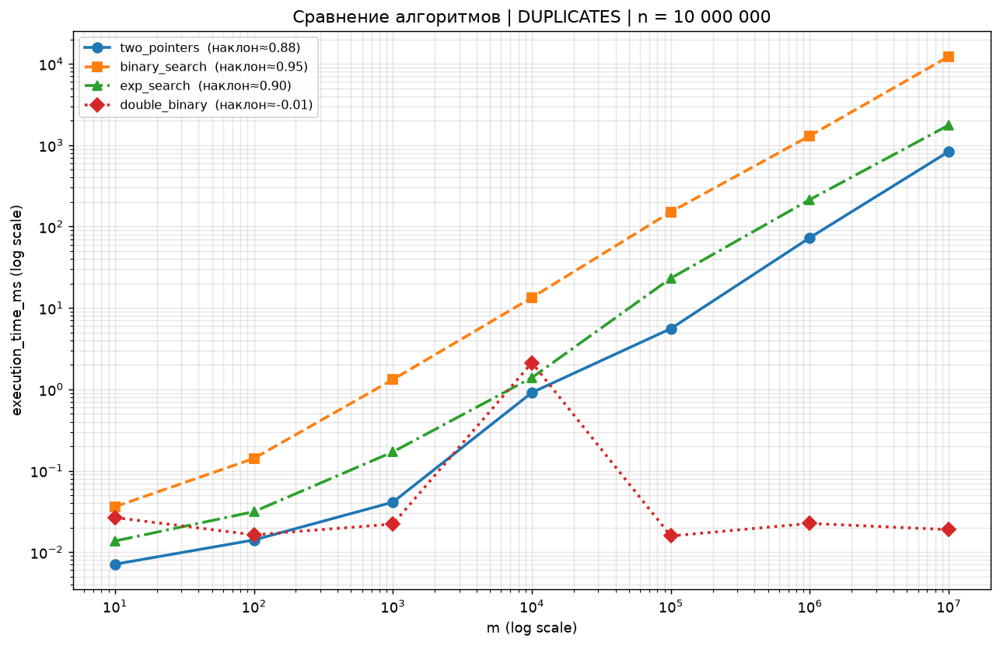

# Лабораторная работа № 1 — Поиск общего элемента в двух отсортированных массивах

## 1. Постановка задачи

Даны два отсортированных массива целых чисел длиной `M` и `N`.

Требуется вернуть `True`, если в массивах есть хотя бы один общий элемент, и `False` — в противном случае.

| Массив A      | Массив B      | Ответ   |
| ------------- | ------------- | ------- |
| `[1, 2, 3]`   | `[3, 4, 5]`   | `True`  |
| `[2, 4, 6]`   | `[3, 5, 7]`   | `False` |
| `[]`          | `[]`          | `False` |

## 2. Цель работы

1. Реализовать **четыре разных алгоритма** решения одной и той же задачи.
2. Экспериментально выяснить, **при каких размерах массивов `M` и `N` какой алгоритм эффективнее**.
3. Сопоставить результаты замеров с теоретическими оценками сложности.

## 3. Исследуемые алгоритмы

Общее для трёх поисковых алгоритмов (пп. 3.2–3.4): если первый массив длиннее второго, они **меняют массивы местами**, т. е. работа всегда ведётся от меньшего массива к большему. Поэтому их фактическая сложность выражается через `min(M, N)` и `max(M, N)`, а результат не зависит от порядка аргументов.

### 3.1. Два указателя — `algorithms/two_pointers.py`

По каждому массиву идёт свой указатель. На каждом шаге сдвигается указатель, указывающий на меньший элемент; равенство элементов означает, что общий элемент найден.

- Время: `O(M + N)`
- Память: `O(1)`

### 3.2. Бинарный поиск — `algorithms/binary_search.py`

Каждый элемент меньшего массива ищется бинарным поиском в большем массиве.

- Время: `O(M · log N)`, в реализации — `O(min(M, N) · log max(M, N))`
- Память: `O(1)`

### 3.3. Экспоненциальный (галопирующий) поиск — `algorithms/exp_search.py`

Элементы меньшего массива перебираются по возрастанию. Внутри большего массива поддерживается монотонно растущая нижняя граница `bound`: от неё шаг удваивается (`1, 2, 4, …`), пока не будет пройдено искомое значение, затем позиция уточняется бинарным поиском внутри найденного короткого интервала.

- Время: `O(M · log(2N/M))`
- Память: `O(1)`

### 3.4. Бинарный поиск с разделением (двойной бинарный) — `algorithms/double_binary.py`

Берётся центральный элемент меньшего массива, бинарным поиском находится его позиция вставки в соответствующем сегменте большего массива. Если совпадения нет, задача рекурсивно решается для двух пар «половинок» слева и справа от найденных позиций.

- Время: `O(M · log(2N/M))`
- Память: `O(log M)` (глубина рекурсии)

### 3.5. Вспомогательная функция — `algorithms/bisect_left.py`

Три поисковых алгоритма используют общую функцию `bisect_left(a, x, lo=0, hi=None)` — **собственную реализацию на чистом Python** (классический цикл `while lo < hi` с делением интервала пополам), а не C-функцию `bisect.bisect_left` из стандартной библиотеки.

- Время: `O(log(hi − lo))`
- Память: `O(1)`

Это принципиально для интерпретации замеров: все четыре алгоритма работают на одном «движке» Python, и ни один из них не получает преимущества за счёт встроенной C-функции.

### Сводная таблица

| Алгоритм | Файл | Время | Память |
|---|---|---|---|
| Два указателя | `algorithms/two_pointers.py` | `O(M + N)` | `O(1)` |
| Бинарный поиск | `algorithms/binary_search.py` | `O(min · log max)` | `O(1)` |
| Экспоненциальный поиск | `algorithms/exp_search.py` | `O(M · log(2N/M))` | `O(1)` |
| Двойной бинарный поиск | `algorithms/double_binary.py` | `O(M · log(2N/M))` | `O(log M)` |

## 4. Структура репозитория

```
labs-aisd/
├── README.md
├── algorithms/
│   ├── bisect_left.py      # собственная реализация bisect_left (чистый Python)
│   ├── two_pointers.py     # два указателя
│   ├── binary_search.py    # бинарный поиск
│   ├── exp_search.py       # экспоненциальный поиск
│   └── double_binary.py    # двойной бинарный поиск
├── testing.py              # генераторы данных, проверка корректности, замеры (pytest)
├── conftest.py             # слияние CSV-результатов воркеров pytest-xdist
├── plot_results.py         # построение графиков по test_results.csv
├── test_results.csv        # сырые данные замеров (784 записи)
├── plots_by_n/             # 144 PNG-графика + winners.csv
├── pyproject.toml
└── uv.lock
```

## 5. Методика эксперимента

Код запуска тестов и проверки работоспособности — `testing.py` (pytest). Каждый тест одновременно:

1. генерирует данные заданного сценария заданных размеров;
2. замеряет время работы алгоритма через `time.perf_counter()` (генерация данных в замер **не** входит);
3. **проверяет корректность**: `assert result == answer`, где эталонный ответ для части сценариев вычисляется пересечением множеств `set(a) & set(b)`.

### 5.1. Сценарии данных

| Сценарий | Генерация | Смысл |
|---|---|---|
| `RANDOM` | Случайные числа из `[0, 10·max(M, N)]`, сортировка | Средний случай |
| `WORST_CASE` | A — только чётные, B — только нечётные числа (`random.sample` по диапазонам с шагом 2) | Пересечений нет: алгоритм обязан доработать до конца. Худший случай для всех алгоритмов, рекомендован в задании |
| `BEST_CASE` | Случайные массивы, общий элемент `0` принудительно ставится в начало обоих | Пересечение находится на первых же элементах |
| `DUPLICATES` | Числа из узких диапазонов `[0, 5]` и `[3, 8]` | Много дубликатов, мало уникальных значений |

### 5.2. Размеры и объём замеров

`M, N ∈ {10¹, 10², …, 10⁷}` во всех комбинациях: 49 пар размеров × 4 сценария × 4 алгоритма = **784 замера** — именно столько записей в `test_results.csv` (колонки: `scenario_name, algorithm, m, n, execution_time, execution_time_ms`).

Замеры запускаются параллельно через `pytest-xdist`: каждый воркер пишет свой `test_results_<worker>.csv`, а `conftest.py` после завершения сессии склеивает их в единый `test_results.csv`.

### 5.3. Графики

`plot_results.py` строит по `test_results.csv` три группы графиков, у всех графиков **обе оси логарифмические** (как рекомендовано в задании):

- **A.** `{algorithm}_{scenario}_n={n}.png` — время от `M` для каждого алгоритма по отдельности, с оценкой наклона log-log прямой;
- **B.** `compare_{scenario}_n={n}.png` — все алгоритмы на одном графике при фиксированном `N`;
- **C.** `compare_{scenario}_all_n.png` — обзорные графики: все алгоритмы × все значения `N`.

Итого 144 PNG в `plots_by_n/`, плюс таблица `plots_by_n/winners.csv` — победитель по медианному времени для каждой пары (сценарий, `N`).

## 6. Как запустить

Требуется Python ≥ 3.11 и [uv](https://docs.astral.sh/uv/).

```bash
uv sync                            # установить зависимости
uv run pytest testing.py -n auto   # тесты + замеры -> test_results.csv
uv run python plot_results.py      # графики -> plots_by_n/
```

Или установить зависимости через pip и запустить через стандартный интерпретатор python
```bash
pip install pytest pytest-xdist matplotlib numpy pandas    # установить зависимости
pytest testing.py -n auto                                  # тесты + замеры -> test_results.csv
python plot_results.py                                     # графики -> plots_by_n/
```

Зависимости (`pyproject.toml`): `pytest`, `pytest-xdist`, `matplotlib`, `numpy`, `pandas`.

## 7. Результаты

Итоги по данным `test_results.csv`: число побед алгоритма в отдельных комбинациях `(M, N)` внутри сценария (всего 49 комбинаций на сценарий):

| Сценарий | two_pointers | binary_search | exp_search | double_binary |
|---|---:|---:|---:|---:|
| `BEST_CASE` | **49** | 0 | 0 | 0 |
| `WORST_CASE` | 12 | **26** | 10 | 1 |
| `RANDOM` | 11 | **20** | 15 | 3 |
| `DUPLICATES` | 19 | **20** | 0 | 10 |

Победитель по медианному времени при фиксированном `N` (из `plots_by_n/winners.csv`):

| Сценарий | Победитель |
|---|---|
| `BEST_CASE` | `two_pointers` при всех `N` |
| `WORST_CASE` | `binary_search` при `N = 10¹, 10²`; `two_pointers` при `N = 10³…10⁵`; `binary_search` при `N = 10⁶, 10⁷` |
| `RANDOM` | `binary_search` при `N = 10¹` и `10⁵`; `exp_search` при `N = 10², 10³, 10⁶, 10⁷`; `two_pointers` при `N = 10⁴` |
| `DUPLICATES` | `binary_search` при `N ≤ 10⁴`; `double_binary` при `N ≥ 10⁵` |

Характерные замеры, худший случай (`WORST_CASE`, время в мс):

| M | N | two_pointers | binary_search | exp_search | double_binary |
|---:|---:|---:|---:|---:|---:|
| 10 | 10⁷ | 1506,7 | **0,11** | 0,17 | 0,14 |
| 10⁷ | 10 | 1097,5 | **0,11** | 4,33 | 0,16 |
| 10³ | 10⁷ | 1179,6 | **5,50** | 28,72 | 23,47 |
| 10⁵ | 10⁷ | 1252,0 | **344,8** | 1001,9 | 1198,6 |
| 10⁶ | 10⁶ | **201,5** | 2454,1 | 2741,0 | 4349,2 |
| 10⁷ | 10⁷ | **2250,5** | 96 771,0 | 26 282,7 | 17 550,8 |

### Ключевые графики

Ниже — самые показательные графики из `plots_by_n/`: по одному на каждый сценарий плюс график точки пересечения в худшем случае. Выбраны сравнительные графики (`compare_*`, все 4 алгоритма при фиксированном `N`): обзорные графики `*_all_n` содержат по 28 линий и для чтения малопригодны. У всех графиков обе оси логарифмические, в легенде указан наклон log-log прямой.



*Рис. 1 — `WORST_CASE`, `N = 10⁷` (главный график работы). Два указателя идут почти горизонтально на уровне 1,0–1,5 с (наклон ≈ 0,03): при любом `M` им приходится проходить весь массив из 10⁷ элементов. Поисковые алгоритмы начинают с 0,1–0,17 мс при `M = 10` (перебирается маленький массив) и растут с наклоном 0,81–0,97; их кривые пересекают два указателя между `M = 10⁵` и `10⁶`: при `M = 10⁵` бинарный поиск ещё в 3,6 раза быстрее (344,8 мс против 1252 мс), при `M = 10⁶` уже в 2,2 раза медленнее (3737,6 мс против 1690,2 мс), а при `M = 10⁷` доходит до 96,8 с — в 43 раза медленнее двух указателей. Нижней линией на участке `M ≪ N` идёт бинарный поиск.*



*Рис. 2 — `WORST_CASE`, `N = 10⁴`: обратная картина и точка пересечения. При `M ≤ 10⁴` два указателя проходят от 0,9 до 2,6 мс: на `M ≤ 10³` поисковые ещё быстрее (0,03–7,5 мс), но на `M = 10⁴` они доходят до 22–52 мс и проигрывают. Как только `M` превышает `N`, поисковые алгоритмы стабилизируются — они перебирают фиксированный массив из 10⁴ элементов внутри огромного — и остаются на уровне 12–200 мс, тогда как два указателя продолжают линейно расти до ~1,4 с при `M = 10⁷`. Видно, что преимущество поиска — именно эффект сильно различающихся размеров, а не «лучший алгоритм» вообще.*



*Рис. 3 — `BEST_CASE`, `N = 10⁵`. Все линии почти горизонтальны (наклоны ≈ 0,02): общий элемент стоит первым, время не зависит от размеров массивов. Два указателя стабильно ниже всех (~0,003–0,007 мс), выше всех — двойной бинарный поиск (0,055–0,12 мс): плата за рекурсию и вызовы `bisect_left` даже при мгновенном ответе.*



*Рис. 4 — `RANDOM`, `N = 10⁷`. Поисковые алгоритмы идут плоско на уровне 0,01–0,2 мс (единственный выброс — двойной бинарный при `M = 10²`, 4,85 мс): общий элемент находится за первые несколько проб (ранний выход). Время двух указателей, наоборот, падает с ростом `M` (наклон ≈ −0,96): чем больше первый массив, тем раньше при линейном проходе встретится общий элемент, а при `M = 10` приходится сканировать почти весь миллионный массив (~2,9 с).*



*Рис. 5 — `DUPLICATES`, `N = 10⁷`. Два указателя растут линейно (наклон ≈ 0,86, до ~790 мс). Бинарный и экспоненциальный поиск уходят вверх до 54,0 с и 9,8 с: при большом `M` они перебирают миллионы элементов, каждый раз вызывая Python-функцию `bisect_left`. Двойной бинарный поиск, наоборот, держится на уровне 0,014–0,03 мс вплоть до `M = 10⁶` — центральный элемент почти сразу попадает в общий диапазон значений 3–5 и рекурсия обрывается, — но при `M = N = 10⁷` срывается до 4,2 с.*

Остальные графики: индивидуальные — `{algorithm}_{scenario}_n={n}.png`, сравнительные для других `N` — `compare_{scenario}_n={n}.png`, обзорные по всем `N` — `compare_{scenario}_all_n.png`.

## 8. Выводы

1. **Лучший случай** (`BEST_CASE`): два указателя выигрывают во всех 49 комбинациях — общий первый элемент находится за несколько сравнений, без накладных расходов на бинарный поиск и рекурсию.
2. **Асимметрия размеров — главный фактор.** Если пересечения нет (`WORST_CASE`), а размеры сильно различаются, бинарный поиск быстрее на порядки: при `M = 10, N = 10⁷` — 0,11 мс против ~1507 мс у двух указателей, которым приходится линейно проходить оба массива целиком. Это прямо подтверждает преимущество `O(min(M, N) · log max(M, N))` над `O(M + N)` при `M ≪ N`.
3. **При сравнимых размерах картина меняется на противоположную.** `log max(M, N)` в Python-реализации — это ~24 итерации цикла на элемент: при `M = N = 10⁶` бинарный поиск тратит 2454 мс против 201 мс у двух указателей, при `M = N = 10⁷` — 96,8 с против 2,25 с. Два указателя берут 12 комбинаций худшего случая — почти все при `M ≥ N` (исключения — `(10, 100)` и `(10⁶, 10⁷)`).
4. **Три поисковых алгоритма симметричны** относительно порядка массивов, так как перебирают меньший массив: для `(10⁷, 10)` и `(10, 10⁷)` бинарный поиск даёт 0,111 и 0,106 мс, двойной бинарный — 0,163 и 0,135 мс. Единственное заметное расхождение — экспоненциальный поиск (4,33 мс против 0,17 мс) — объясняется единичным замером и шумом, а не асимметрией алгоритма.
5. **Экспоненциальный поиск не дал преимущества** над обычным бинарным: 10 побед против 26 в худшем случае и 15 против 20 в среднем. Лучшая теоретическая оценка `O(M · log(2N/M))` при `M ≪ N` не окупается: галопирование — это Python-цикл с удвоением шага, тогда как `bisect_left` сразу делит интервал пополам. На больших `N` экспоненциальный поиск проигрывает бинарному в 1,5–3 раза (например, 1001,9 мс против 344,8 мс при `M = 10⁵, N = 10⁷`).
6. **Двойной бинарный поиск** в худшем случае выиграл лишь однажды (`(10⁷, 10³)`), но незаменим при большом количестве дубликатов: в `DUPLICATES` он побеждает в 10 комбинациях (в том числе при `N = 10⁷` и `M ≤ 10⁶`) и держит ~0,02 мс до `M = 10⁶`, потому что центральный элемент сразу попадает в общий диапазон и рекурсия обрывается. Однако при сравнимых огромных размерах (`M = N = 10⁷`) он срывается до 17,6 с — рекурсия и `bisect_left` дают самую большую константу.
7. **`RANDOM` и `DUPLICATES`**: время в основном определяет то, насколько рано встретится первый общий элемент (ранний выход), а не полная асимптотика — поэтому победитель меняется от комбинации к комбинации, хотя чаще впереди бинарный поиск.

**Итоговая рекомендация по выбору алгоритма:**

| Ситуация | Рекомендуемый алгоритм |
|---|---|
| Размеры сильно различаются (`min(M, N) ≪ max(M, N)`) | Бинарный поиск по большему массиву |
| Размеры сравнимы (`M ≈ N`), пересечения может не быть | Два указателя |
| Общий элемент ожидается в начале массивов | Два указателя |
| Очень много дубликатов, массивы большие и разной длины | Двойной бинарный поиск |
| Огромные массивы сравнимой длины | Два указателя (поисковые алгоритмы проигрывают в 7–43 раза) |

### Ограничения методики

- На каждую комбинацию делается **один замер без повторов и усреднения**, поэтому на малых размерах и в сценариях с ранним выходом результаты заметно шумят; строгие выводы надёжны только для `WORST_CASE` на больших размерах. Отдельные выбросы видны прямо в данных: экспоненциальный поиск даёт 4,33 мс при `(10⁷, 10)` против 0,17 мс при `(10, 10⁷)`, двойной бинарный — 4,85 мс при `(10², 10⁷)` в `RANDOM`.
- Генераторы используют `random` **без фиксированного seed**: наборы данных от запуска к запуску различаются, замеры воспроизводимы лишь приближённо.
- Сравниваются реализации, а не «чистые» алгоритмы: `bisect_left` — собственная Python-функция, поэтому накладные расходы на вызов и цикл входят в замер. Два указателя — единственный алгоритм без вызовов функций во внутреннем цикле, что и даёт ему преимущество в константе при `M ≈ N`.
